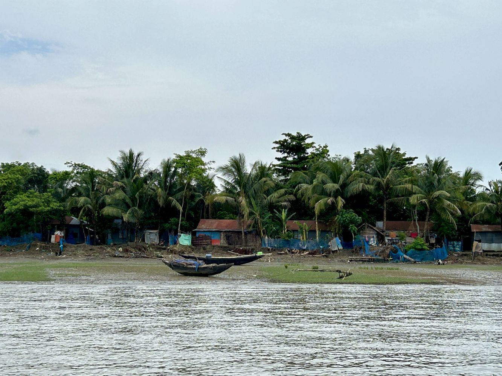

# helenwilsonburns.com

Your academic site. Plain HTML and CSS, no build step — GitHub serves these files
exactly as they are. Edit a file, commit, and the change is live in about ten seconds.

```
index.html     all your copy, between the tags
styles.css     colours, type, spacing — the design layer
cv.pdf         served at helenwilsonburns.com/cv.pdf
CNAME          your domain; don't delete this file
images/        every photo on the site
```

---

## One-time setup

### 1. Make the repository

On github.com, click **New repository**. Name it:

```
hwb_site
```

Set it to **Public** (GitHub Pages needs this on free accounts). Don't add a README —
there's one here already.

### 2. Upload these files

On the empty repository page, click **uploading an existing file**. Drag in everything
from this folder, including the `images` folder and the files whose names start with a
dot. Commit.

### 3. Turn on Pages

**Settings → Pages.** Under *Build and deployment*, set Source to **Deploy from a branch**,
branch `main`, folder `/ (root)`. Save.

Your site is now live at **helenwilsonburns.github.io/hwb_site/**. Check it there before
touching DNS.

Under *Custom domain*, enter `helenwilsonburns.com` and save. Tick **Enforce HTTPS** once
it becomes available — it can take an hour or so while a certificate is issued. Once the
domain is working, the site serves at the root of helenwilsonburns.com; the `/hwb_site/`
subpath is only how GitHub's own domain addresses it.

### 4. Point the domain

At whoever you bought helenwilsonburns.com from, in the DNS settings, delete the records
currently sending the domain to Google Sites, then add these.

Four **A** records, host `@`:

```
185.199.108.153
185.199.109.153
185.199.110.153
185.199.111.153
```

One **CNAME** record, host `www`, pointing to:

```
helenwilsonburns.github.io
```

That's your bare GitHub domain with no repository name on the end — correct as written,
even though the repo is called `hwb_site`.

If your registrar also offers AAAA records, add these four for IPv6. Optional but worth it:

```
2606:50c0:8000::153
2606:50c0:8001::153
2606:50c0:8002::153
2606:50c0:8003::153
```

Also delete whatever records currently point the domain at Google Sites — usually a CNAME
on `www` aimed at `ghs.googlehosted.com`. Leave any **MX records** alone if you receive
email at this domain.

DNS usually takes 15 minutes to a few hours. The site works at
`helenwilsonburns.github.io/hwb_site/` the whole time, so nothing is ever down.

---

## Everyday editing

All of this works from github.com in a browser. Open the file, click the **pencil icon**,
make the change, then **Commit changes** at the bottom. Wait ten seconds and reload your site.

### Change wording

Open `index.html`. Your text sits between tags, like this:

```html
<p>I am an environmental demographer and a NIH T32-funded postdoctoral fellow...</p>
```

Edit the words, leave the `<p>` and `</p>` alone. Use `&amp;` if you need an ampersand.

The file has comment markers to help you find your place:

```html
<!-- ===== ABOUT: edit the text between the <p> and </p> tags ===== -->
```

### Swap a photo

Easiest way: give the new photo the **same filename** as the one you're replacing, then
upload it into `images/` and let it overwrite. Nothing else changes.

Otherwise, upload it under a new name and update the filename in `index.html`:

```html

```

Change the caption on the line below it, and update the `alt` text too — that's what a
screen reader announces and what shows if the image fails to load.

Resize photos to about 1400px wide before uploading. Phone photos are 4000px+ and will
make the page slow.

### Add a paper

Inside a project, copy one whole `<li class="paper">` block and edit it. The status label
is set by the class on the `<span>`:

| Class | Shows as |
|---|---|
| `s-pub` | Published |
| `s-cond` | Conditionally accepted |
| `s-rev` | Under review |
| `s-near` | Near submission |
| `s-prog` | In progress |

### Add a project

Copy one whole `<li class="project">` block. Two things to update beyond the text:

**The tags** — each is one `<li class="tag">` with a coloured dot:

```html
<li class="tag"><span class="dot mig"></span>migration</li>
```

Dot classes are `mig`, `env`, `hea`, `rur`.

**The stripe** down the left edge, which should list the same domains in the same order.
For three domains:

```html
style="--stripe:linear-gradient(to bottom,#eda100 0 33.3%,#008300 33.3% 66.6%,#2a78d6 66.6% 100%)"
```

For two, use `0 50%` and `50% 100%`. The colours:

| Domain | Hex | Dot class |
|---|---|---|
| migration | `#eda100` | `mig` |
| environment | `#008300` | `env` |
| population health | `#e34948` | `hea` |
| rurality | `#2a78d6` | `rur` |

### Update your CV

Upload the new PDF over `cv.pdf` in the root, keeping that exact filename. The download
button needs no change.

---

## Two things worth knowing

**Don't delete `CNAME`.** It's what tells GitHub your domain. If it goes, the site falls
back to helenwilsonburns.github.io.

**If something looks broken after an edit**, you almost certainly deleted a `<` or a `>`.
Go to the repository's **Commits**, open your last one, and click **Revert**. That undoes
it cleanly.

---

## Checking before you commit

GitHub shows a **Preview** tab while editing, but it won't render the design. To see the
real thing, commit and look at the live site — or edit, and if you don't like it, revert.
